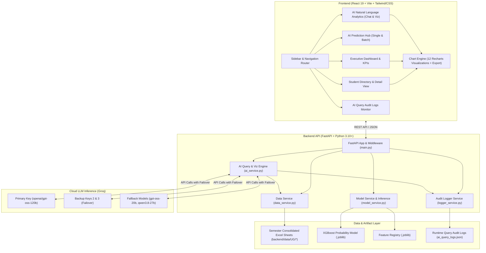

# Project Context & Architecture Specification

## Academic Intelligence Platform — Student Analytics & AI Risk Engine

---

## 1. Executive Summary

The **Academic Intelligence Platform** is an enterprise-grade academic analytics dashboard, machine learning risk assessment engine, and conversational AI system designed for higher education institutions and engineering colleges.

The platform ingests multi-semester consolidated academic records across undergraduate departments, aggregates cohort and student-level KPIs, predicts student failure probabilities using an **XGBoost Classifier**, and delivers an interactive natural-language analytics engine powered by **Groq Large Language Models (LLMs)** with automated multi-key and multi-model rate-limit failover.

---

## 2. System Architecture

The platform follows a decoupled, service-oriented architecture:



---

## 3. Technology Stack

### Backend
- **Framework:** FastAPI (High-performance async Python web framework)
- **Server:** Uvicorn (ASGI web server)
- **Runtime:** Python 3.10 / 3.11 / 3.12
- **Data Manipulation:** Pandas, NumPy, OpenPyXL
- **Machine Learning:** XGBoost (1.7+ / 2.0+), Scikit-learn, Joblib
- **Generative AI:** Groq Python SDK (`groq`), Pydantic v2
- **Environment Management:** Python-dotenv

### Frontend
- **Framework:** React 19
- **Build Tool:** Vite 8 (Ultra-fast HMR and Rollup/Rolldown production bundling)
- **Routing:** React Router v7 (`react-router-dom`)
- **Charting & Visualization:** Recharts, Canvas HTML2Canvas, FileSaver, Lucide React icons
- **Styling:** Custom Modular CSS with CSS Variables, responsive grid layouts, and glassmorphism accents

---

## 4. Directory & File Inventory

```
Student-analytics-bit/
├── .gitignore                                      # Comprehensive root git exclusion rules
├── README.md                                       # Main repository overview & quick start guide
├── PROJECT_CONTEXT.md                              # Full architectural specification (this document)
├── requirements.txt                                # Top-level Python dependency specification
│
├── images/                                         # High-resolution screenshots & UI designs
│   ├── department_overview.jpeg                    # Main Executive Dashboard screenshot
│   ├── student_analytics.jpeg                      # Individual Student Analytics screenshot
│   ├── ai_chat_assistant.jpeg                      # AI Analytics Chat interface
│   ├── architecture_mockup.jpeg                    # Hardware & system architecture render
│   ├── hod_portal_mockup.jpeg                      # Management HOD portal render
│   └── SendAnywhere_936665/                        # Archive of original design renders
│
├── testing/                                        # Standalone ML validation scripts
│   ├── test.py                                     # Baseline prediction tester
│   ├── test_new.py                                 # Feature scaling tester
│   ├── test_new_1.py                               # Risk band threshold validator
│   └── output/                                     # Directory for generated Excel test reports
│
├── training/                                       # Model training and artifact generation
│   ├── train.py                                    # Initial training script
│   ├── train2.py                                   # Second iteration training pipeline
│   ├── train_new.py                                # Current production XGBoost probability trainer
│   ├── test_extraction.py                          # Excel extraction validation
│   └── model/
│       ├── new/                                    # Production model artifacts
│       │   ├── prob_features.joblib                # Feature column names
│       │   └── xgboost_probability_model.joblib    # Trained XGBoost Booster
│       └── old/                                    # Legacy models preserved for benchmarking
│
└── student-analysis-dashboard/                     # Core web application repository
    ├── test_all_endpoints.py                       # End-to-end API integration verification
    ├── test_endpoints.py                           # Quick endpoint sanity check
    │
    ├── backend/                                    # FastAPI backend service
    │   ├── main.py                                 # API route declarations, CORS, startup hooks
    │   ├── app.py                                  # Alternative ASGI entrypoint
    │   ├── data_service.py                         # Excel parser, aggregation, filtering & stats
    │   ├── model_service.py                        # ML inference, risk categorization & batch parser
    │   ├── ai_service.py                           # Natural language AI query planner & graph engine
    │   ├── logger_service.py                       # Audit logging subsystem for AI queries
    │   ├── requirements.txt                        # Backend-specific Python requirements
    │   ├── .env.example                            # Safe template environment variables
    │   ├── test_model_service.py                   # Automated tests for ML model inference
    │   ├── test_bulk_excel.py                      # Automated tests for batch Excel processing
    │   ├── test_groq_failover.py                   # Unit tests for multi-key/model failover logic
    │   ├── test_ai_service.py                      # General tests for AI natural language queries
    │   ├── test_ai_graph_engine.py                 # Numerical parity tests for AI graph outputs
    │   ├── test_real_groq_only.py                  # Integration tests for live/mocked Groq planner
    │   │
    │   ├── model/                                  # Backend model storage directory
    │   │   ├── prob_features.joblib                # Production feature registry
    │   │   └── xgboost_probability_model.joblib    # Production XGBoost probability model
    │   │
    │   └── data/UG/                                # Department academic result spreadsheets
    │       ├── AD/ (Artificial Intelligence & Data Science - Sem I, III, V, VII)
    │       ├── AG/ (Agricultural Engineering)
    │       ├── AL/ (Artificial Intelligence & Machine Learning)
    │       ├── BM/ (Biomedical Engineering)
    │       ├── BT/ (Biotechnology)
    │       ├── CB/ (Computer Science & Business Systems)
    │       ├── CD/ (Computer Science & Design)
    │       ├── CE/ (Civil Engineering)
    │       ├── CS/ (Computer Science & Engineering)
    │       ├── CT/ (Computer Technology)
    │       ├── EC/ (Electronics & Communication Engineering)
    │       ├── EE/ (Electrical & Electronics Engineering)
    │       ├── EI/ (Electronics & Instrumentation Engineering)
    │       ├── FD/ (Fashion Technology)
    │       ├── FT/ (Food Technology)
    │       ├── ISE/ (Information Science & Engineering)
    │       ├── IT/ (Information Technology)
    │       ├── MC/ (Mechatronics Engineering)
    │       ├── ME/ (Mechanical Engineering)
    │       └── TT/ (Textile Technology)
    │
    └── frontend/                                   # Modern React 19 + Vite web client
        ├── index.html                              # Root HTML5 template
        ├── package.json                            # Frontend npm scripts & dependencies
        ├── vite.config.js                          # Vite bundler & backend proxy configuration
        ├── .env.example                            # Frontend environment configuration template
        │
        └── src/
            ├── main.jsx                            # React 19 application entry point
            ├── App.jsx                             # Router setup, global layout, navigation
            ├── index.css                           # Design tokens, variables, typography, animations
            │
            ├── pages/                              # Primary top-level route views
            │   ├── Dashboard.jsx                   # High-level KPIs, grade & class distributions
            │   ├── PredictionHub.jsx               # ML single student & bulk batch predictor
            │   ├── StudentsList.jsx                # Filterable, paginated student directory
            │   ├── StudentDetail.jsx               # Comprehensive individual student profile
            │   ├── AIAnalytics.jsx                 # Conversational AI visualization & graph studio
            │   └── AILogs.jsx                      # Real-time query audit and debug log viewer
            │
            ├── components/                         # Common shared layout & widgets
            │   ├── Sidebar.jsx                     # Collapsible, modern glassmorphic navigation
            │   └── StatCard.jsx                    # Reusable KPI counter card with trend badges
            │
            ├── components/charts/                  # Visualization rendering engine (Recharts)
            │   ├── DynamicChartRenderer.jsx        # Smart dispatcher that maps specs to chart components
            │   ├── ChartContainer.jsx              # Wrapper with card styling, fullscreen & controls
            │   ├── ChartHeader.jsx                 # Title, description, badge, and toolbar container
            │   ├── ChartToolbar.jsx                # Chart type switcher, export triggers, zoom
            │   ├── ChartLegend.jsx                 # Custom responsive interactive legend
            │   ├── ChartTooltip.jsx                # Rich contextual hover tooltip with value formatting
            │   ├── ChartConfigPanel.jsx            # User customizations (color palette, axis labels)
            │   ├── ChartEmptyState.jsx             # Clean empty state with helpful illustration
            │   ├── ChartErrorState.jsx             # Graceful chart crash recovery & error banner
            │   ├── ChartLoadingState.jsx           # Polished shimmering skeleton loading UI
            │   ├── BarChartComponent.jsx           # Vertical & multi-series grouped bar chart
            │   ├── HorizontalBarChartComponent.jsx # Horizontal ranking bar chart
            │   ├── StackedBarChartComponent.jsx    # 100% or absolute stacked category bar chart
            │   ├── LineChartComponent.jsx          # Multi-point trend line with smooth bezier curves
            │   ├── AreaChartComponent.jsx          # Gradient-filled progression area chart
            │   ├── PieChartComponent.jsx           # Donut & Pie chart with active segment hover
            │   ├── RadarChartComponent.jsx         # Multi-axis polygon performance radar chart
            │   ├── ScatterChartComponent.jsx       # Correlation & cluster scatter plot
            │   ├── colorSystem.js                  # Semantic, accessible color palettes & tokens
            │   ├── chartFormatters.js              # Unit formatting (%, GPA, currency, counts)
            │   └── chartExport.js                  # PNG, SVG, and CSV client-side export engine
            │
            └── services/
                └── api.js                          # Axios / Fetch client for all backend endpoints
```

---

## 5. Academic Data Model & Pipeline

### Excel Schema Parsing
The backend loads consolidated results sheets (`*-CONS-WO.xlsx`) using `data_service.py`. Each spreadsheet contains:
- **Header Blocks:** Institutional metadata, department code, regulation, and semester.
- **Student Rows:** Register number, student name, and course marks.
- **Course Columns:** Course code (e.g., `CS3501`), course credits, continuous internal assessment (CIA) marks, end-semester exam marks, total marks, and letter grade (`O`, `A+`, `A`, `B+`, `B`, `C`, `U`/`RA`, `W`, `AB`).
- **Summary Columns:** SGPA, CGPA, total credits, pass/fail status, and arrears count.

### Department & Semester Auto-Discovery
The `data_service.py` module recursively traverses `backend/data/UG/` to discover all department folders (e.g., `CS`, `IT`, `AD`, `ME`, `EC`) and roman-numeral semester subfolders (`I`, `III`, `V`, `VII`). It dynamically normalizes department codes and aggregates all records into memory at startup.

### Performance Grade Conversion
| Letter Grade | Grade Point | Performance Level | Result |
| :---: | :---: | :---: | :---: |
| **O** | 10 | Outstanding | PASS |
| **A+** | 9 | Excellent | PASS |
| **A** | 8 | Very Good | PASS |
| **B+** | 7 | Good | PASS |
| **B** | 6 | Above Average | PASS |
| **C** | 5 | Average | PASS |
| **U / RA** | 0 | Re-Appearance (Arrear) | FAIL |
| **AB** | 0 | Absent | FAIL |
| **W** | 0 | Withdrawn | WITHDRAWN |

---

## 6. Machine Learning Risk Prediction Engine

### Model Architecture
- **Algorithm:** XGBoost Probability Classifier (`XGBClassifier`)
- **Trained Artifact:** `xgboost_probability_model.joblib`
- **Feature Set (`prob_features.joblib`):**
  1. `Avg_Internal_Pct`: Average percentage achieved across all internal assessments in the semester.
  2. `Min_Internal_Pct`: Lowest percentage scored in any individual subject assessment.
  3. `Low_Internal_Count`: Total number of subjects where the internal mark fell below 50%.

### Dynamic Mark Normalization
Colleges record continuous internal assessments on varying scales depending on regulations:
- 40 marks (Scale factor: $100 / 40 = 2.5$)
- 50 marks (Scale factor: $100 / 50 = 2.0$)
- 60 marks (Scale factor: $100 / 60 = 1.667$)

The engine auto-detects the maximum marks per subject column and normalizes all marks to a $0 - 100\%$ scale before feeding them to the XGBoost inference pipeline.

### Risk Categorization Bands
| Risk Status | Failure Probability Range | Recommended Action |
| :--- | :---: | :--- |
| **SAFE (PASS)** | $0.0\% - 29.9\%$ | Student is on track. Maintain regular academic engagement. |
| **MEDIUM RISK** | $30.0\% - 64.9\%$ | Moderate risk. Faculty mentoring and targeted remedial sessions recommended. |
| **HIGH RISK (FAIL)** | $65.0\% - 100.0\%$ | Critical risk of semester failure. Immediate dean/HOD intervention required. |

---

## 7. Conversational AI Analytics & Visualization Subsystem

### Architectural Flow
When a user asks an academic question (e.g., *"Compare pass percentage between CS, IT, and ME"* or *"Show top 10 students by SGPA"*):

1. **Rule-Based Fast Router:**
   - Evaluates whether the query matches known common patterns (e.g., top performers, grade distribution, department pass percentages).
   - If matched, serves the data and visualization specification instantly **without consuming Groq LLM tokens**.
2. **Groq LLM Query Planner:**
   - If no cached rule matches, the prompt is dispatched to Groq's high-speed inference engine using a multi-turn planner prompt.
   - Generates a structured JSON object containing:
     - `intent`: `"database_query"`, `"clarification"`, or `"general_conversation"`
     - `queryPlan`: Entity, filters, grouping fields, metric aggregations, sorting, and row limits.
     - `graphSpecification`: Recommended visualization type, axes definitions, series, title, and color hints.
3. **Multi-Key Failover Engine:**
   - Reads `GROQ_API_KEY`, `GROQ_API_KEY_2`, `GROQ_API_KEY_3`, or comma-separated `GROQ_API_KEYS`.
   - On encountering HTTP 429 (Rate Limit Exceeded) or HTTP 401 (Auth Failure), immediately tries the next key in the pool.
4. **Multi-Model Cascading Fallback:**
   - If all keys reach their rate limit on the primary model (`openai/gpt-oss-120b`), the engine cascades to secondary models:
     1. `openai/gpt-oss-20b`
     2. `qwen/qwen3.8-27b`
5. **Data Execution & Schema Repair:**
   - Executes the query plan against the in-memory academic dataset.
   - Passes the raw data and specification through `validate_and_repair_specification()` to ensure axis fields and data types strictly align with the returned records.
6. **Audit Logging Subsystem:**
   - Automatically writes a record to `logger_service.py` detailing execution latency, model used, key index, data row count, and any failovers.

---

## 8. Dynamic Chart & Visualization Engine

Located in `frontend/src/components/charts/`, this layer converts raw JSON datasets and specifications into responsive, interactive charts:

### Supported Chart Types
1. **Vertical Bar Chart (`bar`):** Single and multi-category comparisons.
2. **Horizontal Bar Chart (`horizontal_bar`):** Ranked items (e.g., top students, subject averages).
3. **Grouped Bar Chart (`grouped_bar`):** Side-by-side metric comparison (e.g., Pass vs. Fail count).
4. **Stacked Bar Chart (`stacked_bar`):** Composition breakdown (e.g., grade tiers across batches).
5. **Line Chart (`line`):** Progression over time or semesters.
6. **Area Chart (`area`):** Trend analysis with smooth gradient fills.
7. **Pie & Donut Charts (`pie`, `donut`):** Proportional distribution (e.g., class divisions).
8. **Radar Chart (`radar`):** Multi-dimensional subject or department benchmarking.
9. **Scatter Plot (`scatter`):** Correlation between internal marks and final SGPA.

### UX & Export Features
- **Client-Side Export:** Download high-resolution PNGs via HTML Canvas, vector SVGs, and formatted CSV spreadsheets.
- **Dynamic Color Schemes:** Default indigo/violet, emerald eco, cyan ocean, warm amber, and high-contrast colorblind-safe palettes.
- **Fail-Safe Rendering:** Includes `ChartErrorState`, `ChartEmptyState`, and shimmering `ChartLoadingState`.

---

## 9. API Endpoints Reference

### Dashboard & Analytics
- `GET /api/summary`: Returns college-wide summary KPIs (total students, pass percentage, average SGPA, total departments). Optional `?department=` and `?semester=` query parameters.
- `GET /api/top-performers`: Returns top students ranked by SGPA. Optional `?limit=` (default 5).
- `GET /api/class-division`: Returns student breakdown across Distinction, First Class, Second Class, and Fail.
- `GET /api/grade-distribution`: Returns letter grade counts and percentages.
- `GET /api/subject-analytics`: Returns subject-wise pass rates, failure rates, and average marks.
- `GET /api/semester-trends`: Returns SGPA progression across Semesters I through VIII.
- `GET /api/departments`: Returns list of all available department codes.
- `GET /api/semesters`: Returns list of all available semesters.

### Student Directory
- `GET /api/students`: Returns paginated student records with search, department, semester, and status filters.
- `GET /api/students/{register_number}`: Returns comprehensive academic history and subject-level marks for a single student.

### Machine Learning Risk Hub
- `POST /api/predict/single`: Accepts `{ student_id, student_name, assessments: [{ subject_code, raw_score, max_score }] }` and returns pass/fail probability, risk band, and faculty recommendations.
- `POST /api/predict/bulk`: Accepts a multipart `.xlsx` file upload and returns cohort risk predictions, summary counts, and at-risk course detection.
- `GET /api/model/status`: Returns ML model operational status, booster version, and feature registry.

### Conversational AI Studio & Audit Logs
- `POST /api/ai/query`: Accepts `{ question, history, mode }` and returns answer, structured table data, and complete `graphSpecification`.
- `GET /api/ai/logs`: Returns paginated audit logs of past natural language queries.
- `GET /api/ai/logs/{id}`: Returns complete prompt, raw Groq response, and query plan for a single query.
- `GET /api/ai/logs/stats`: Returns query success rates, average latency, and query volume.
- `POST /api/ai/logs/clear`: Wipes audit logs from memory and storage.

---

## 10. Security & Secret Protection

- **No Secrets in Source:** API keys are never hardcoded. All keys are resolved at runtime via environment variables.
- **Git Ignore Security:** `.env` files are ignored by git in `.gitignore`. Only `.env.example` templates with empty placeholders are committed.
- **Runtime Key Masking:** In logs, error messages, and API responses, API keys are securely masked to display only prefix and trailing characters (e.g., `gsk_...2Jug`).
- **Input Validation:** All file uploads undergo MIME-type and extension validation to prevent arbitrary file upload vulnerabilities.
