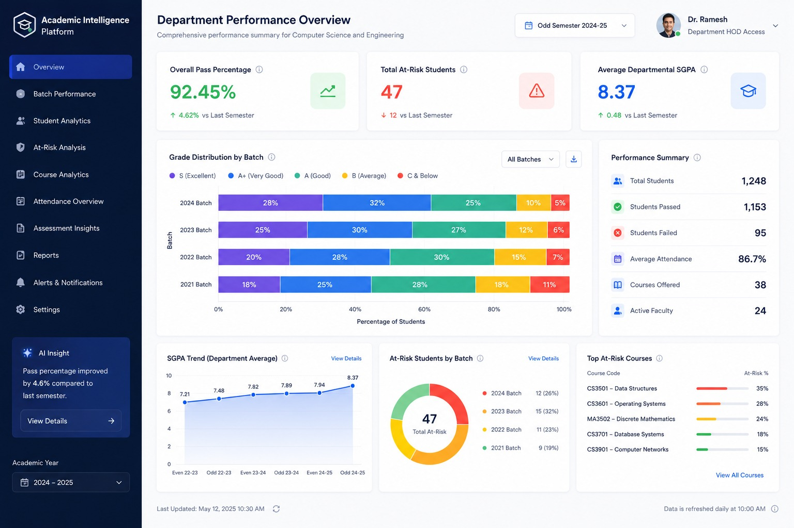
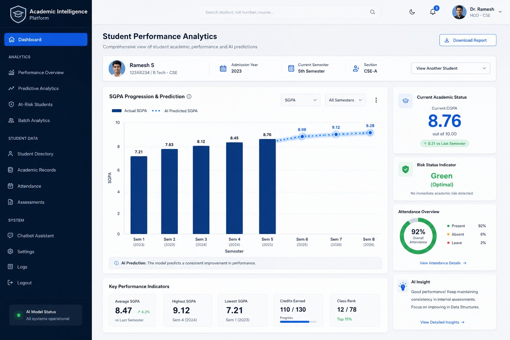
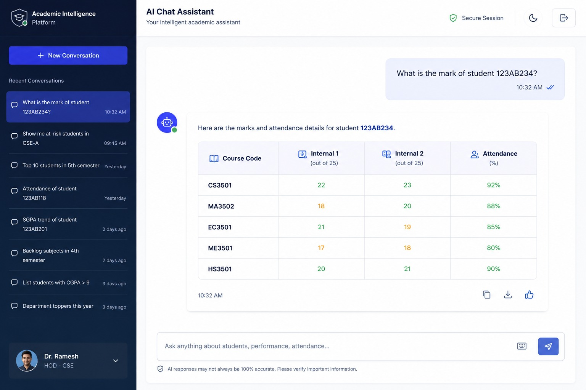
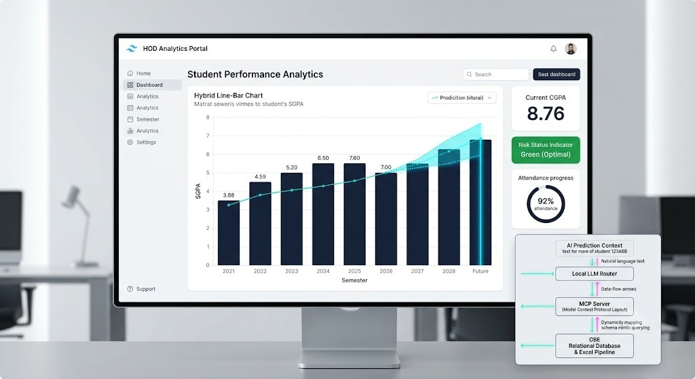

# 🎓 Academic Intelligence Platform — Student Analytics & AI Risk Engine

[](https://react.dev/)
[](https://vitejs.dev/)
[](https://fastapi.tiangolo.com/)
[](https://www.python.org/)
[](https://xgboost.ai/)
[](https://groq.com/)
[](LICENSE)

An enterprise-grade academic analytics platform, machine learning failure risk prediction engine, and conversational AI data studio engineered for colleges and universities.

The platform processes multi-semester consolidated academic records across 20 undergraduate departments, analyzes cohort progression, predicts individual and batch student failure probabilities via an **XGBoost Classifier**, and delivers natural-language conversational analytics powered by **Groq LLMs** with automated multi-key and multi-model rate-limit failover.

---

## 📸 Platform Showcase

### 📊 Department Performance Overview
Comprehensive executive dashboard tracking pass percentages, grade distributions, SGPA progression trends, at-risk student cohorts, and course difficulty benchmarks.


---

### 👤 Individual Student Performance Analytics
Granular student profile view featuring historical SGPA trajectory, credit completion, subject-by-subject assessment breakdown, and AI risk projections.


---

### 💬 Conversational AI Analytics & Visualization Studio
Ask any academic question in natural language and receive formatted data tables, dynamic charts (Bar, Line, Donut, Radar, Scatter), and insights.


---

### 🖥️ Management Portal & Hardware Integration
HOD Portal and institutional workflow architecture.


---

## ✨ Core Capabilities

### 1. 📈 Department & Cohort Intelligence
- **Real-Time KPIs:** Overall pass rate, average departmental SGPA, total at-risk count, and cohort size.
- **Grade Distribution:** Tier breakdown across Outstanding (`O`), First Class (`A+`/`A`), Second Class (`B+`/`B`), and Arrears (`U`/`RA`).
- **Course Difficulty Profiling:** Auto-detects courses with high failure rates to alert department heads early.
- **20 Departments Supported:** CS, IT, AD, AG, AL, BM, BT, CB, CD, CE, CT, EC, EE, EI, FD, FT, ISE, MC, ME, and TT across Semesters I to VII.

### 2. 🧠 Machine Learning Risk Engine (XGBoost)
- **Probability Scoring:** Predicts pass vs. fail probability based on continuous internal assessment marks.
- **Dynamic Scale Normalization:** Automatically adapts to assessments graded out of 40, 50, or 60 marks.
- **Risk Categorization:**
  - 🟢 **SAFE (PASS):** Failure probability $< 30\%$
  - 🟡 **MEDIUM RISK:** Failure probability $30\% - 65\%$ (remedial coaching recommended)
  - 🔴 **HIGH RISK (FAIL):** Failure probability $> 65\%$ (immediate faculty intervention)
- **Batch Processing:** Upload raw semester Excel result sheets (`.xlsx`/`.xls`) to generate cohort-wide risk reports.

### 3. 🤖 Conversational AI & Natural Language Querying (Groq)
- **Smart Query Planner:** Translates natural language queries (e.g., *"Compare pass percentage between CS, IT, and ME"*) into structured queries and interactive visualizations.
- **Multi-Key Rate-Limit Failover:** Seamlessly rotates through primary, secondary, and tertiary Groq API keys upon encountering rate limits (HTTP 429).
- **Cascading Model Fallback:** If all keys reach quota on the primary model (`openai/gpt-oss-120b`), queries automatically cascade to `openai/gpt-oss-20b` and `qwen/qwen3.8-27b`.
- **Zero-Token Local Caching:** Common analytics queries (top performers, grade distribution, pass percentages) are routed through a fast local rule engine to save API tokens.
- **Audit Logs:** Full logging of execution latencies, token usage, models used, and query debug trees.

### 4. 📊 Professional Dynamic Charting Engine
- **12 Visualization Types:** Bar, Horizontal Bar, Grouped Bar, Stacked Bar, Line, Area, Pie, Donut, Radar, and Scatter.
- **Export Capabilities:** 1-click export to high-resolution PNG, SVG vector graphics, or raw CSV spreadsheets.
- **Customization:** Dynamic theme palettes (Modern Indigo, Emerald Eco, Cyan Ocean, Warm Amber, Accessible High-Contrast).

---

## 🛠️ Technology Stack

| Layer | Technologies |
| :--- | :--- |
| **Frontend** | React 19, Vite 8, React Router v7, Recharts, Lucide React, HTML2Canvas, FileSaver |
| **Backend API** | FastAPI, Uvicorn, Python 3.10+ |
| **Machine Learning** | XGBoost (`XGBClassifier`), Scikit-learn, Joblib, Pandas, NumPy |
| **Generative AI** | Groq Python SDK, Pydantic v2 |
| **Data Ingestion** | OpenPyXL, Pandas Excel Parser |
| **Configuration** | Python-dotenv, Cross-platform POSIX/Windows path resolution |

---

## 🚀 Quick Start Guide

### Prerequisites
- **Python:** 3.10, 3.11, or 3.12 ([Download Python](https://www.python.org/downloads/))
- **Node.js:** 18.0 or higher (v20+ LTS recommended) ([Download Node.js](https://nodejs.org/))
- **Git**

---

### 1. Clone the Repository
```bash
git clone https://github.com/Ramesh-Sakthivel-18/Student-analytics-bit.git
cd Student-analytics-bit
```

---

### 2. Backend Setup & Startup

1. **Create and activate a virtual environment:**
   ```bash
   # Windows (PowerShell)
   python -m venv .venv
   .\.venv\Scripts\Activate.ps1

   # Linux / macOS
   python3 -m venv .venv
   source .venv/bin/activate
   ```

2. **Install Python dependencies:**
   ```bash
   pip install -r requirements.txt
   ```

3. **Configure Environment Variables:**
   ```bash
   cd student-analysis-dashboard/backend
   cp .env.example .env
   ```
   Open `.env` in your text editor and add your Groq API key(s):
   ```env
   GROQ_API_KEY=gsk_your_primary_key_here
   GROQ_API_KEY_2=gsk_your_secondary_key_here   # Optional backup
   GROQ_API_KEY_3=gsk_your_tertiary_key_here    # Optional backup
   ```

4. **Launch the FastAPI Server & Auto-Initialize SQLite Database:**
   ```bash
   python main.py
   ```
   *Executing `python main.py` automatically initializes the secured SQLite database (`users.db`), creates encrypted user tables, seeds institutional reviewer accounts, and boots up the FastAPI backend.*

   - API Server: `http://localhost:8000`
   - Interactive OpenAPI Documentation: `http://localhost:8000/docs`
   - Seed Demo Accounts:
     - **Dean of Academics:** `admin@bit.edu` (Password: `Admin@1234`)
     - **HOD CS:** `hod.cs@bit.edu` (Password: `Hod@1234`)
     - **IT Faculty:** `faculty@bit.edu` (Password: `Faculty@1234`)


   ```bash
   # Alternatively, with live auto-reload:
   uvicorn main:app --reload --host 0.0.0.0 --port 8000
   ```
   - API Server: `http://localhost:8000`
   - Interactive OpenAPI Documentation: `http://localhost:8000/docs`

---

### 3. Frontend Setup & Startup

1. **Open a new terminal window and navigate to the frontend directory:**
   ```bash
   cd student-analysis-dashboard/frontend
   ```

2. **Install npm dependencies:**
   ```bash
   npm install
   ```

3. **Configure Frontend Environment (Optional):**
   ```bash
   cp .env.example .env
   ```

4. **Start the Vite development server:**
   ```bash
   npm run dev
   ```
   - Web Application: `http://localhost:5173`

---

## 🧪 Testing & Verification

The project includes test suites for machine learning, data parsing, and AI engine:

```bash
# Test XGBoost single-student inference
python student-analysis-dashboard/backend/test_model_service.py

# Test bulk spreadsheet parsing & batch prediction
python student-analysis-dashboard/backend/test_bulk_excel.py

# Test Groq multi-key / multi-model failover logic
python -m unittest student-analysis-dashboard/backend/test_groq_failover.py

# Test offline ML feature scaling
python testing/test.py
python testing/test_new_1.py

# Build frontend production bundle
cd student-analysis-dashboard/frontend && npm run build
```

---

## 📂 Repository Structure

```
Student-analytics-bit/
├── README.md                                       # Main documentation (this file)
├── PROJECT_CONTEXT.md                              # Deep architectural specification
├── requirements.txt                                # Python dependencies
├── images/                                         # Screenshots and UI previews
│
├── testing/                                        # Standalone ML validation scripts
│   ├── test.py
│   ├── test_new.py
│   └── test_new_1.py
│
├── training/                                       # Model training pipelines & artifacts
│   ├── train_new.py                                # Production XGBoost model trainer
│   └── model/new/                                  # Trained .joblib model files
│
└── student-analysis-dashboard/                     # Full-stack application
    ├── test_all_endpoints.py                       # API verification suite
    │
    ├── backend/                                    # FastAPI service
    │   ├── main.py                                 # API router & middleware
    │   ├── data_service.py                         # Excel parser & statistical aggregations
    │   ├── model_service.py                        # ML inference & batch prediction
    │   ├── ai_service.py                           # Groq query planner & graph engine
    │   ├── logger_service.py                       # Query audit logger
    │   ├── .env.example                            # Template environment file
    │   ├── data/UG/                                # Semester result spreadsheets (.xlsx)
    │   └── model/                                  # Production .joblib models
    │
    └── frontend/                                   # React 19 + Vite dashboard
        ├── src/
        │   ├── App.jsx                             # Router & navigation
        │   ├── pages/                              # Page views (Dashboard, AIAnalytics, etc.)
        │   ├── components/charts/                  # 12 chart components & export utilities
        │   └── services/api.js                     # API client
        └── vite.config.js                          # Vite configuration
```

---

## 🔒 Security & Secret Protection

- **No Hardcoded Secrets:** Keys and sensitive credentials are read strictly from environment variables.
- **Git Protection:** `.env` files and runtime log files (`ai_query_logs.json`) are completely excluded via `.gitignore`.
- **Key Masking:** In logs and UI responses, API keys are always masked (e.g., `gsk_...2Jug`).
- **File Validation:** Bulk file uploads enforce `.xlsx` and `.xls` MIME-type validation.

---

## 📄 License

This project is licensed under the MIT License — see the [LICENSE](LICENSE) file for details.
